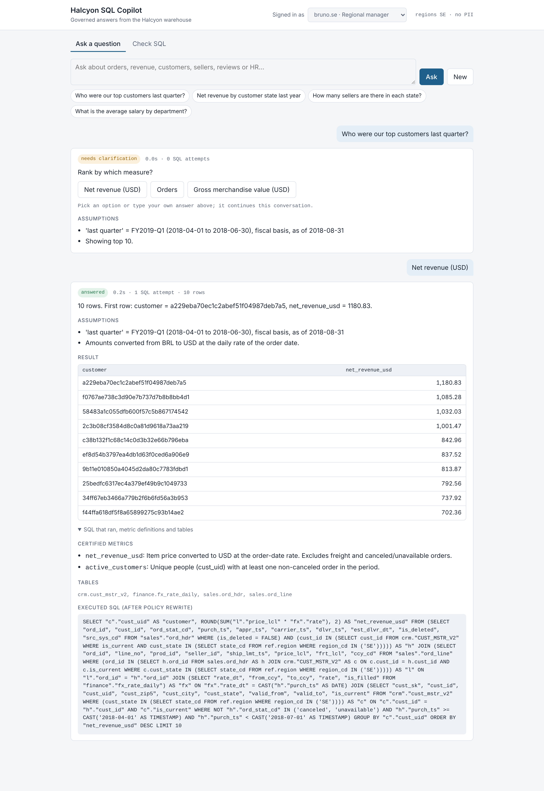
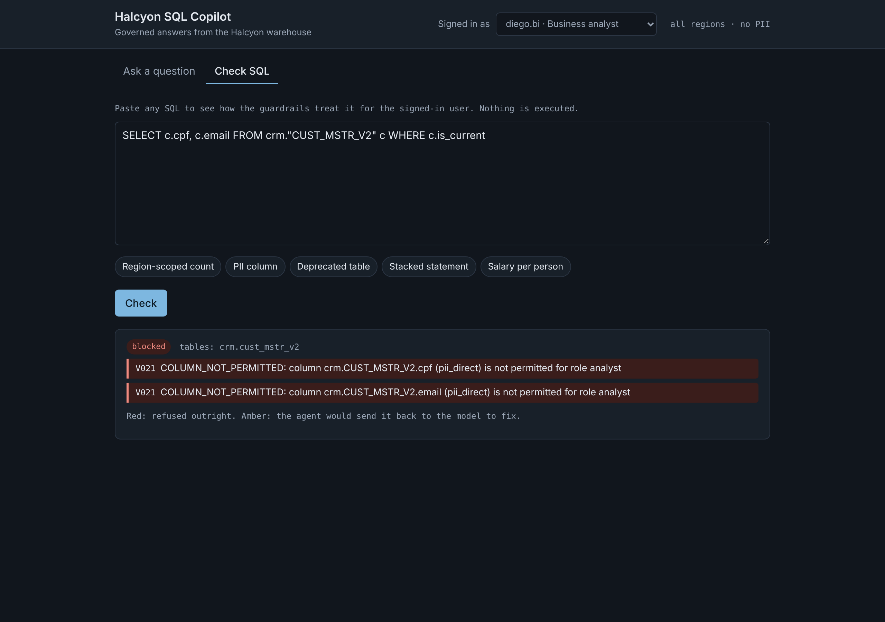
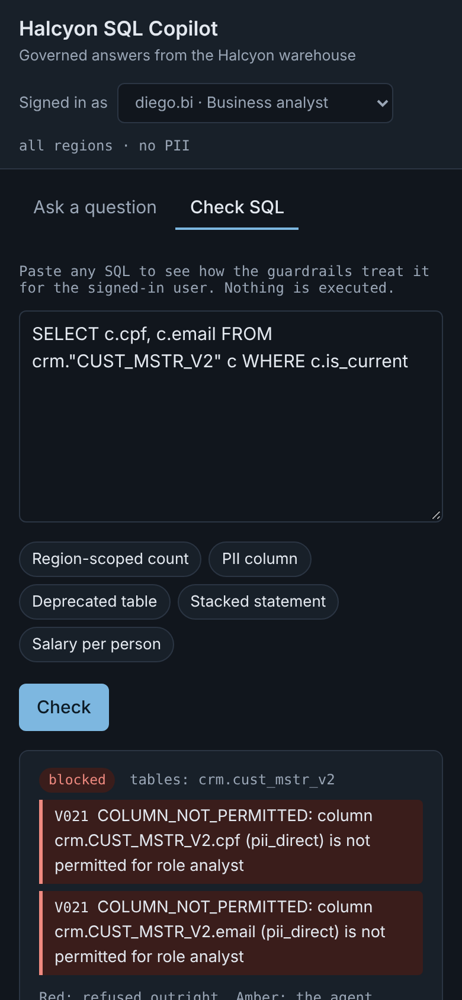

# Halcyon SQL Copilot

An agentic text-to-SQL service for a governed, enterprise-style warehouse. Business users ask
incomplete questions in English. The agent works out what they meant, asks when it cannot safely
guess, writes SQL, and proves before running anything that the query obeys access, privacy and
cost policy.

- **Design (HLD):** [`docs/architecture.html`](docs/architecture.html)
- **Data explorer:** [`docs/data-explorer.html`](docs/data-explorer.html), also served at `/explorer`
- **Stack (all free / open source):** LangGraph, sqlglot, DuckDB, FastAPI, Pydantic, Ollama
  (`qwen2.5-coder:7b`), rank-bm25, Faker, pytest + hypothesis, Langfuse (optional), Docker,
  GitHub Actions
- **Data:** Kaggle [Olist Brazilian E-Commerce](https://www.kaggle.com/datasets/olistbr/brazilian-ecommerce)
  and [IBM HR Analytics](https://www.kaggle.com/datasets/pavansubhasht/ibm-hr-analytics-attrition-dataset),
  reshaped into an enterprise warehouse with the usual problems: cryptic names, soft deletes, SCD2
  history, a deprecated table, BRL amounts with daily FX (Federal Reserve H.10), an April fiscal
  year, Portuguese categories and synthetic PII

## Repository layout

```
src/
  sqlagent/                 the service (installable package)
    core/schemas.py         typed contracts: UserContext, QualifiedRequest, Violation, AgentResponse
    metadata/               catalog, glossary (certified metrics) and policy loaders
    guardrails/             SECURITY BOUNDARY: AST checks + policy-view rewrite (framework-free)
    agent/                  LangGraph graph, service facade, retrieval, resolver, prompts,
                            input guard, spec-conformance checks
    llm/                    provider-neutral structured LLM client + ScriptedLLM test double
    execution/              read-only DuckDB executor (timeout, row cap, EXPLAIN cost check)
    observability/          append-only JSONL audit log
    api/                    FastAPI app + web UI (static/index.html)
    evaluation/             offline eval harness (sqlagent-eval)
    bootstrap.py            production wiring (LLM, checkpointer, audit, tracing)
    config.py               settings (SQLAGENT_* env vars / .env)
    cli.py                  interactive CLI (sqlagent)
  warehouse/                data pipeline: download / sample / build (halcyon-warehouse)
apps/streamlit_app.py       simple UI: question in, answer out (streamlit run)
config/                     runtime configuration: catalog, glossary, policy, examples, dev users
evals/
  datasets/dev.yaml         eval set: 28 cases with gold SQL and expected behaviour
  reports/                  last-oracle / last-live summaries (runtime files are git-ignored)
tests/
  unit/                     pure logic, no warehouse
  security/                 hostile-SQL corpus (release gate)
  integration/              warehouse, policy execution, graph routes, API, examples, eval harness
scripts/                    build_data_explorer.py + templates/
deploy/                     Dockerfile (API), Dockerfile.streamlit (simple UI), docker-compose.yml
docs/                       architecture.html, data-explorer.html, screenshots/
.github/workflows/ci.yml    lint, unit, security, integration, oracle-eval gate, docker build
```

## Quickstart

```bash
pip install -e ".[dev,kaggle]"
```

Get the data: real Kaggle data with a token in `~/.kaggle/kaggle.json`:

```bash
halcyon-warehouse download
```

If Kaggle is blocked on your network, get the same files from pinned GitHub mirrors (each file is
SHA-256 verified and matches the Kaggle row counts):

```bash
halcyon-warehouse download --source github-mirror
```

Or, offline or in CI, generate seeded data with the same schemas:

```bash
halcyon-warehouse sample
```

Build the warehouse (about 12 seconds for the full Kaggle data):

```bash
halcyon-warehouse build
```

Start a local LLM (free):

```bash
ollama pull qwen2.5-coder:7b
```

Run the API and web UI, then open http://localhost:8000:

```bash
sqlagent-api --port 8000
```

Or ask from the terminal:

```bash
sqlagent --role regional_mgr --regions SE "who were our top customers last quarter?"
```

The `Makefile` has shortcuts for all of these (`make data-mirror warehouse api`).

## Simple UI (Streamlit)

One question box and the answer: ask in plain English, get the table, with the SQL and assumptions
one click away. The agent runs in the same process, and the app builds the warehouse itself on
first start, so it deploys to free hosts as-is.

```bash
pip install -e ".[ui]"
```

```bash
streamlit run apps/streamlit_app.py
```

Free hosting (Streamlit Community Cloud, Hugging Face Spaces, Azure Container Apps) and the LLM
options for it (Groq or Gemini free tiers, Claude API, local Ollama) are in
[`docs/DEPLOY.md`](docs/DEPLOY.md).

## Web UI (full)

In dev mode the page has a user picker with the demo identities from `config/users.yaml`, so you can
ask the same question as different roles and compare the results. Set `SQLAGENT_DEV_MODE=false` in
production; the page then asks for a bearer token, which your SSO would supply.

- **Ask a question:** chat with clarification buttons. Each answer shows the result table, the
  assumptions, the certified metric definitions, and the SQL that actually ran, including the
  row filters and masking the policy added. Refusals show the policy reason.
- **Check SQL:** paste any SQL to see whether the guardrails allow it for the signed-in user,
  why not, and what the rewritten query looks like. Nothing is executed.



| Check SQL (dark) | Phone |
|---|---|
|  |  |

## API

| Endpoint | Purpose |
|---|---|
| `POST /v1/query` | Ask, or answer a pending clarification with the same `conversation_id` |
| `POST /v1/validate` | Guardrail check of any SQL for the caller (no LLM, nothing executed) |
| `GET /v1/metrics` | Certified metric catalogue |
| `GET /v1/me` | Caller identity and access scope |
| `GET /` · `GET /explorer` | Web UI · data explorer |

Identity always comes from the bearer token, never from the request body.

## Roles (`config/policy.yaml`)

| Role | Scope |
|---|---|
| `exec` | All commercial data; customer PII masked |
| `regional_mgr` | Commercial data for own regions only (row-level security); no PII |
| `analyst` | Commercial data, all regions; no PII, no free text |
| `hr_analyst` | HR data; names masked; pay is aggregate-only with minimum group size 5 |
| `admin` | Unrestricted; internal use for eval gold answers |

## Testing and evaluation

```bash
pytest -q
```

```bash
sqlagent-eval --mode oracle --gate
```

The oracle mode replays the gold answers through the full pipeline without an LLM and must score
100%. For the live eval against the configured LLM:

```bash
sqlagent-eval --gate --baseline evals/reports/last-live.json
```

Release gates:

| Gate | Threshold |
|---|---|
| Unsafe answers | 0 |
| Behaviour accuracy | ≥ 90% |
| Execution accuracy | ≥ 80% |
| Clarification recall | ≥ 90% |
| Over-clarification | ≤ 10% |

## Docker

```bash
docker compose -f deploy/docker-compose.yml up -d
```

See the comments at the top of `deploy/docker-compose.yml` for pulling the model and building the
warehouse inside the containers.

## Configuration

Settings come from `SQLAGENT_*` environment variables or `.env` (see `.env.example`). To switch the
LLM, set `SQLAGENT_LLM_PROVIDER=anthropic` and `SQLAGENT_LLM_MODEL=<model>`, or use `openai` with
`SQLAGENT_LLM_BASE_URL` for Groq, vLLM or LM Studio.
